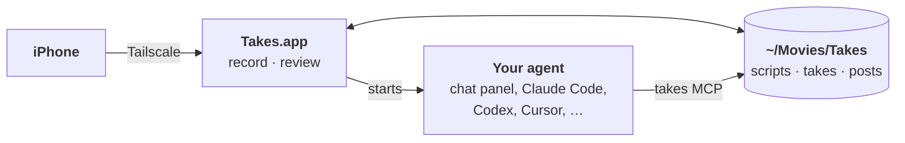

<p align="center"></p>

<p align="center">
  Record on your Mac or iPhone. Your agent (<a href="https://claude.com/claude-code">Claude Code</a>, Codex or pi) writes the script,<br>
  cuts the edit and drafts the posts.<br>
  <a href="https://gettakes.app"><b>gettakes.app</b></a>
</p>

<p align="center">
  
  
  
  
  
</p>

Takes shows each post the way LinkedIn, X, YouTube or Shorts will show it, so you review the real thing. No coding needed and no account. Your videos, scripts and chats stay in folders on your Mac. Takes sends none of them, and your agent talks only to its own provider. Takes only checks for updates, and sends usage counts if you say yes ([privacy](https://gettakes.app/privacy)).

## Install

Paste this in Terminal:

```sh
curl -fsSL https://gettakes.app/install | bash
```

It installs Takes, ffmpeg and Apple's developer tools, then opens Takes. Takes works with Claude Code, Codex or pi: when one of them is on your Mac, the script uses it and helps you sign in. With none, it installs Claude Code. Run it again to update. You can [read the script](https://gettakes.app/install) first: it is 133 lines.

<details>
<summary>Other ways to install</summary>

- **Download:** get `Takes.dmg` from [Releases](https://github.com/marvtub/takes-public/releases/latest) and drag Takes to Applications. Takes is not notarized yet, so open System Settings > Privacy & Security and click **Open Anyway** once ([pictures of each step](https://gettakes.app/download)). Then click **Finish setup** in the sidebar.
- **From source:** clone this repo, `brew install ffmpeg`, then `./build.sh install`.

</details>

## How a video goes

1. **Storyboard.** Ask *"storyboard my next video"*. Your agent writes the script and sketches each shot.
2. **Record.** Read off a teleprompter that follows your voice. Camera and screen record as two synced files. Star the take you keep.
3. **Post.** Ask *"cut my last take"* and *"write the posts"*. Review each draft as the platform shows it, leave comments on a frame or a line, and schedule it.

<p align="center"></p>

<p align="center"></p>

<p align="center"></p>

<p align="center"></p>

<p align="center"></p>

<p align="center"></p>

<p align="center"></p>

## On your iPhone

Your videos, takes, storyboards and posts, from anywhere. Ask Takes from the phone too. Record a take on the phone and it lands in the session on your Mac. The phone reaches your Mac over [Tailscale](https://tailscale.com); nothing goes through a server of ours.

To install it you need Xcode and an Apple ID: `TAKES_TEAM=<team id> ios/install.sh`. With a free Apple ID, install it again every 7 days.

## How it works

Your library is plain folders in `~/Movies/Takes`. The app records into them, your agent reads and writes them through the `takes` MCP server, and the app updates when a file changes. The chat panel in the app runs on Claude Code, Codex or pi, on your own plan: the line under "Takes" in the chat picks the agent and the model, and Settings › Agents shows which agents can open your library.

The server works with any MCP agent. On its first launch Takes adds it to each one on your Mac: Claude Code, Codex, Cursor, Gemini CLI, opencode, pi (with pi-mcp-adapter) and Claude Desktop. It also adds its skills (`takes-storyboard`, `takes-video-edit`, `takes-image-prompt`) to `~/.claude/skills` and `~/.agents/skills`, and downloads the [HyperFrames](https://github.com/heygen-com/hyperframes) skills (HeyGen) for motion graphics. So you can ask from any of them too. Plugins › Skills turns each skill on or off and adds any skill from GitHub. Another agent, or one you installed later: Settings › Agents › Connect, or `python3 /Applications/Takes.app/Contents/Resources/takes_mcp.py --setup`.

- Start a new agent session after the first launch: a session that was already open does not see the server.
- **Cursor** gets a short list of 30 tools (script, takes, storyboard, edit, jobs, comments, posts, plan), because Cursor uses only about 40 tools across all its servers. For every tool, set `"env": {"TAKES_TOOLS": "all"}` in the `takes` entry of `~/.cursor/mcp.json`.
- **Gemini CLI** turns MCP servers off in folders you have not trusted. Trust the folder once when Gemini asks.
- The server runs on the Python in Apple's developer tools. Without them, Takes' Finish setup has an Install button.



## Good to know

- **Needs:** a Mac with Apple silicon, macOS 15+, and Claude Code, Codex or pi on your own plan.
- **Optional:** `whisper` for transcripts. A Gemini key for storyboard sketches, B-roll names and best cuts: Settings › Gemini says what it adds and saves it.
- **Questions and ideas:** [Discussions](https://github.com/marvtub/takes-public/discussions). Takes does not take pull requests, so one person keeps it consistent. Forks are welcome. More in [CONTRIBUTING.md](CONTRIBUTING.md) and [SECURITY.md](SECURITY.md).
- The pictures are the real app on a made-up library.

## Support

Takes is free. If it saves you time, you can buy me a coffee:

<p>
  <a href="https://paypal.me/webtotheflow"></a>
  <a href="https://venmo.com/u/MarvinAziz"></a>
</p>
